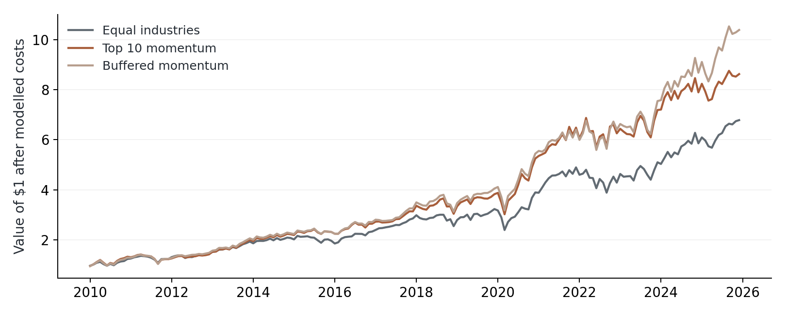

# Industry momentum and portfolio selection

**George Dharma · Quant portfolio project 11 · Python 3.12**

Do industries with stronger past returns make better portfolio holdings after trading costs? This project compares equal industry weights, the ten strongest industries and a rule that keeps some existing holdings to reduce trading.

**[Read the worked notebook](notebooks/analysis.ipynb)** · [Browse the Python code](equity/) · [Read the report](docs/report.pdf) · [Run it yourself](docs/RUNNING.md)

The notebook includes explanations, formulas, tables and saved charts. You can review it on GitHub without running the analysis.

## Main finding

The selected top-10 rule has 14.42% compound annual growth after assumed costs in 2010–2025, versus 12.71% for equal industry weights. The buffered comparison reaches 15.76%, but was not the validation winner. The active-return and factor-alpha intervals include zero.



**Scope:** Kenneth R. French research industry portfolios, using one archived data vintage. These are not directly tradable funds. Selection uses 2000–2009; 2010–2025 is the final evaluation period. The final results are now known, so this is a reproduction of the completed experiment.

## What the code demonstrates

Data validation · lagged momentum signals · chronological evaluation · portfolio accounting · transaction costs · factor regression.

## Find your way around

| File or folder | Purpose |
| --- | --- |
| [`notebooks/analysis.ipynb`](notebooks/analysis.ipynb) | Start here: the complete worked example |
| [`equity/engine.py`](equity/engine.py) | Data parsing, lagged signals, portfolio rules, costs and statistics |
| [`equity/analysis.py`](equity/analysis.py) | Development, selection record, final evaluation and exports |
| [`run_analysis.py`](run_analysis.py) | Run the full calculation from one command |
| [`data/`](data/) | Fixed inputs and their source information |
| [`outputs/`](outputs/) | Saved tables and charts; regenerated by the code |
| [`tests/`](tests/) | 21 financial and numerical checks |
| [`docs/METHODOLOGY.md`](docs/METHODOLOGY.md) | Detailed assumptions, conventions, sources and limitations |

## Run the analysis

Download the complete repository using **Code → Download ZIP**, then extract it. Use Python 3.12 and open a terminal in the folder containing `run_analysis.py`.

On Windows PowerShell:

```powershell
py -3.12 -m venv .venv
.\.venv\Scripts\python.exe -m pip install -r requirements.txt
.\.venv\Scripts\python.exe run_analysis.py
.\.venv\Scripts\python.exe -m unittest discover -s tests -v
```

For macOS/Linux, JupyterLab and troubleshooting, see [the step-by-step instructions](docs/RUNNING.md). The analysis runs from bundled inputs without API keys. Rerunning overwrites generated outputs. [Validation notes](docs/VALIDATION.md) explain the checks performed.

## Sources and reuse

Source attribution and data provenance are retained in [the methodology](docs/METHODOLOGY.md) and `data/`. See [source and rights notes](NOTICE.md). This repository presents an independent portfolio research exercise; the referenced organisations do not endorse it.
